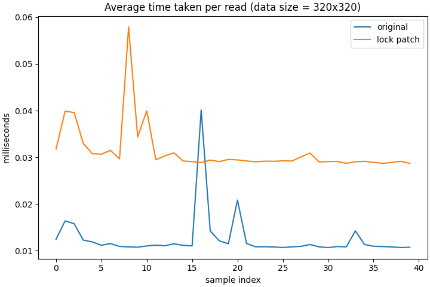
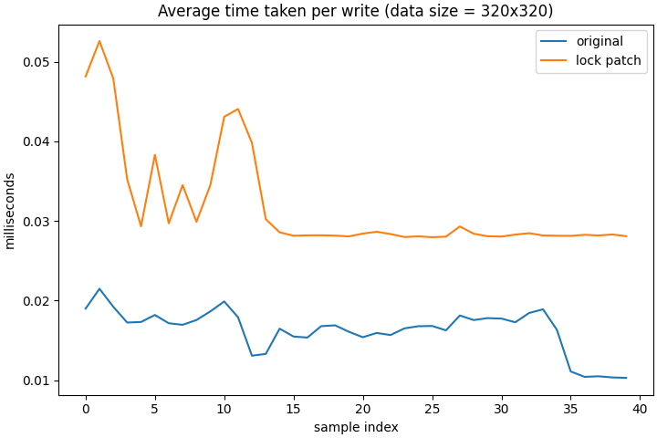
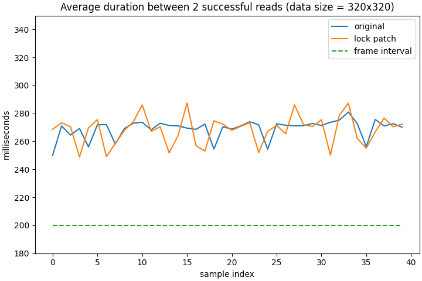

# frigate_robust_frame_cache

This project, built upon the codebase of [frigate v0.17.1](https://github.com/blakeblackshear/frigate/tree/v0.17.1), implements a full fix to a concurrency issue identified in the internal frame cache framework.

## What is the issue?
In short, the internal frame cache framework utilises a ring buffer of shared memory to cache frames from a detection stream, and a cached frame will be replaced with a new one every time the entire cache space is traversed. However, frame cache updates happen silently without synchronisation with modules that use this framework, and those late in the frame processing pipeline still referencing old frames could end up reading wrong data, or even corrupt contents if reading and writing a cache slot coincide.

Note that the maintainers of frigate have introduced additional timestamp checks (presumed to be available after v0.19.0) to cope with the raised issue, but unfortunately their fix still leaves some narrow cases unattended. Considering that there exist various aspects of a system, including
* Host capability
* Docker configuration
* Frigate configuration
* Camera settings
* Loading dynamic

that all can influence the speed of accumulating and consuming cached frames (and thus are factors in triggering this issue), a holistic approach which robustly addresses it in its entirety would be much preferred in my opinion.

## Why v0.17.1?
**Not** that this issue only affects this version; it is simply because I am using v0.17.1 for my home surveillance setup, and therefore it is more convenient for me to test patches targeting that particular version.

## What is in the patch?
This patch introduces 2 main changes to tackle this issue:
1. Frame versioning that allows for identifying specific frame versions stored in the same cache slot.
2. A shared-memory-based locking mechanism that works in multi-process scenarios. This is used to create read/write critical sections to bundle version verification and a group of operations requiring a particular version of a frame into one atomic step of frame access.

Please check [this commit](https://github.com/nothingstopsme/frigate_robust_frame_cache/commit/6e9eeb36fffbb35988dc361e266ab6215fdea4be) for more details.

## How about the performance impact of locking?
A few notes:
1. Reader locks are deployed when only read access is needed in this patch; this reduces contention among readers and is especially helpful in a situation where read operations dominate, like access to cached frames.
2. Lock acquisition in this patch is set to non-blocking mode by default, so that a frame-drop-like behaviour is triggered when cache slots are busy. This implies that there will be no waiting time wasted on being blocked by a lock.
3. Each cache slot is associated with its own lock; since an independent frame cache space is allocated for each camera, locks are not shared across cameras, either.

So the prime concern would be the cost of maintaining lock states, and below are the results of profiling a single frame read/write operation under the frame cache framework with/without the patch on my device.
| Read | Write |
| :---: | :---: |
|  |  |
| lock penalty: +0.018 ms | lock penalty: +0.012 ms |
| as % of a frame interval\[[1](#frame_interval_footnote1)\]: 0.0091% | as % of a frame interval\[[1](#frame_interval_footnote1)\]: 0.0059% |

\[<a name="frame_interval_footnote1">1</a>\]: Assuming frame rate = 5 => frame interval = 200 ms

While locking does incur some performance penalty, the amount is relatively small compared with the scale of the frame interval normally used for detection streams. In fact, once all the costs involved in the existing frame processing flow are included, that penalty should become rather insignificant, as evidently shown in the following profile result:

where reading durations are measured in a setup of 10 reader participants simulating the actual data flow:

1. Frame data is received from stdout by capture_frames() and stored into the frame cache.
2. The name of each new frame gets published via a notification channel.
3. Readers read a new message from a notification channel.
4. Readers retrieve the frame named in that message and perform some work on it.

and there are barely any differences in performance after this patch is applied.

